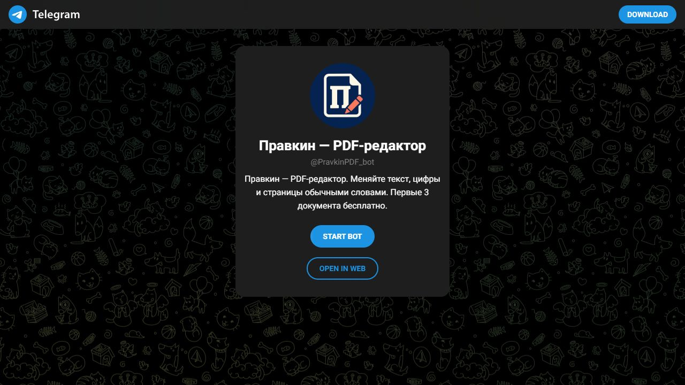

# Yaroslav Konev

**Websites, interactive experiences & Telegram bots**

I build websites with a sense of place and tools that simplify everyday work: clear interfaces, considered motion, and useful Telegram conversations.

[Discuss a project →](https://t.me/YasikKonco) · [More work on FL.ru](https://www.fl.ru/users/konevfreemsk/portfolio/)

---

### 01 / Loki

**A house revealed like a short film.**

The forest comes first. As you scroll, the home emerges frame by frame and the story moves inside. Loki gives an architectural presentation the pacing of a short film.

Interface composition · Responsive layout · Scroll motion

[View the case →](https://yaroslavkonevmsk-max.github.io/yaroslavkonevmsk-max/loki.html)

### 02 / House Walk

**Could you picture your life here?**

Circle the house, step inside and wander through the first floor. Switch from daylight to evening, try furnishing options and imagine where your life would unfold.

Interactive experience · Navigation · Property presentation

[View the case →](https://yaroslavkonevmsk-max.github.io/yaroslavkonevmsk-max/house-walk.html)

### 03 / Pravkin

**One small change. One simple conversation.**

Send a PDF, describe the edit in ordinary words and review the result before approving delivery. Pravkin turns everyday document changes into a guided Telegram conversation.

Telegram bot · Conversational UX · Python · Limited PDF beta

[View the case →](https://yaroslavkonevmsk-max.github.io/yaroslavkonevmsk-max/pravkin.html) · [Open the bot →](https://t.me/PravkinPDF_bot)

---

**Have a place, product, or workflow to improve?**

Send a short brief, a reference, and what the visitor should be able to do. [Let's talk on Telegram →](https://t.me/YasikKonco)
