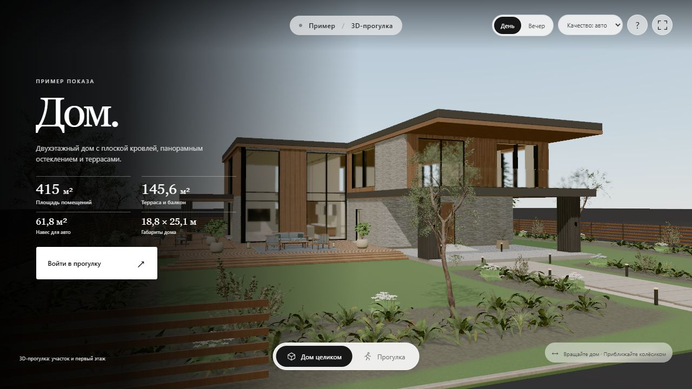

[← Selected work](../README.md)

# House Walk

**Could you see your life unfolding here?**

A floor plan tells you where the rooms are. House Walk gives you a way to explore how the place might feel. Circle the house, approach the entrance and move through the first floor at your own pace. Return in evening light, then try a different furnishing option. The story changes because you are the one moving through it.

The profile cover is an AI-assisted concept visualization based on this house. The image below is a capture from the working 3D demo.

### The experience

This real-time WebGL demo lets visitors orbit the exterior, explore the grounds, open the entrance door and walk the first floor. Day and evening settings and furnishing variants help them picture more than one way to inhabit the space. The interface keeps navigation and scene controls close without crowding the model.

It is a working local demonstration of an interactive property presentation. The image above shows the actual unbranded browser demo, not a separate architectural render.

### What this case shows

The exterior depicts a two-storey house; the walkthrough covers the grounds and first floor only. The interiors and surroundings are demonstrative. There is no public live build or release of the underlying models and assets in this case.

[Discuss an interactive tour for your property →](https://t.me/YasikKonco) · [Back to selected work](../README.md)
