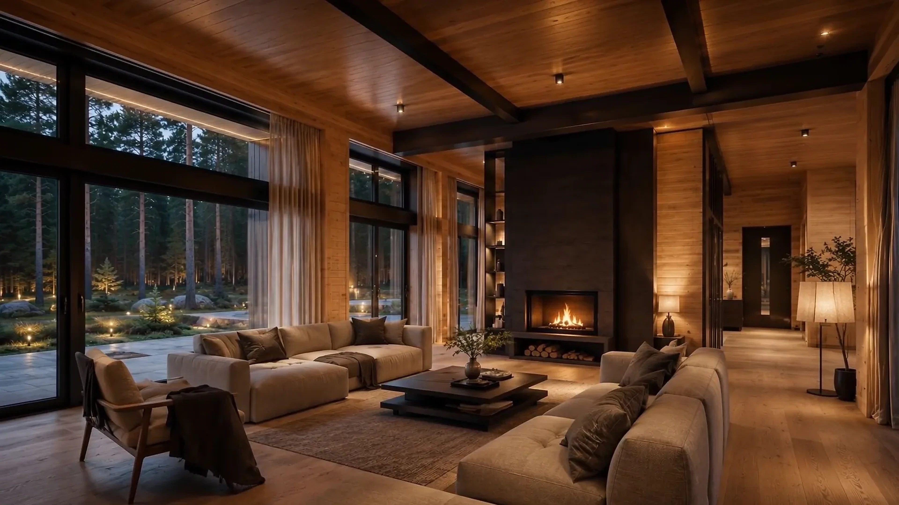
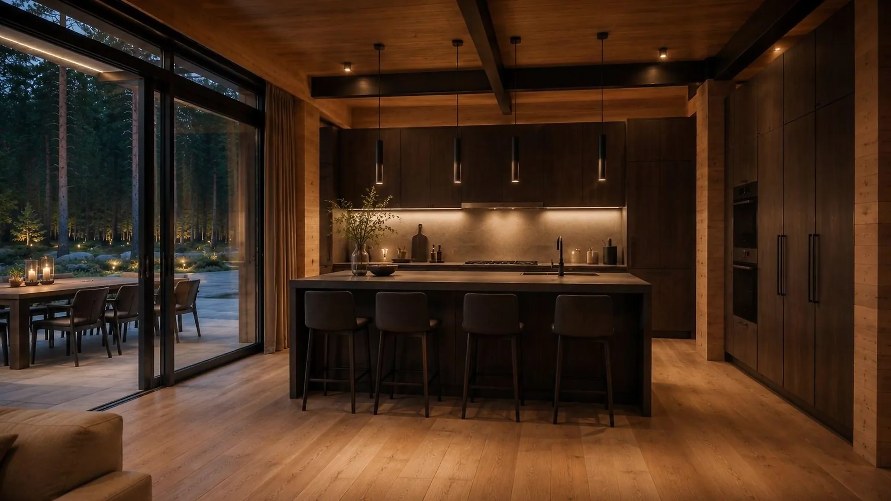

[← Selected work](../README.md)

# Loki

**A house revealed one scene at a time.**

First, the forest. Then the glow of a house between the trees. Keep scrolling and the story moves indoors, from the exterior into rooms that feel connected to the landscape around them.

Loki explores what happens when a property website takes its cues from film. The visitor sets the pace. Each new view has a reason to appear, giving the architecture room to make an impression before the interface asks for attention.

### The experience

Four chapters guide the journey from setting to interior. A rendered image sequence and scroll motion create the transitions; responsive layouts and quiet typography keep the focus on the home. The web interface, motion and image-sequence presentation are the work shown in this case.

The result is a continuous visual story through the forest setting, living room and kitchen. The frames below and above come from the actual local project.

### What this case shows

Loki tells its story through a rendered image sequence controlled by scrolling. The selected images are 3840 × 2160, upscaled from 1920 × 1080. The available project is a built site, so this case presents the experience rather than a complete source release.

[Discuss a presentation for your property →](https://t.me/YasikKonco) · [Back to selected work](../README.md)
